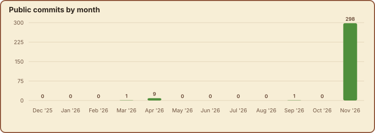

# About

I [read](https://z-library.sk/profile/45325055/0f1fbf), [code](https://github.com/cmduyeen/self-study), and cook.

[ISFJ](https://www.16personalities.com/isfj-personality).

# My stuff

<!-- MY-STUFF:START -->

2026-30R

<ol>
<li><code>NOV-14</code> -&gt; <a href="https://github.com/cmduyeen/malaysia-lunar-calendar">malaysia-lunar-calendar</a></li>
<li><code>NOV-14</code> -&gt; <a href="https://github.com/cmduyeen/singapore-lunar-calendar">singapore-lunar-calendar</a></li>
<li><code>NOV-14</code> -&gt; <a href="https://github.com/cmduyeen/korean-lunar-calendar">korean-lunar-calendar</a></li>
<li><code>NOV-14</code> -&gt; <a href="https://github.com/cmduyeen/macao-lunar-calendar">macao-lunar-calendar</a></li>
<li><code>NOV-14</code> -&gt; <a href="https://github.com/cmduyeen/hong-kong-lunar-calendar">hong-kong-lunar-calendar</a></li>
<li><code>NOV-14</code> -&gt; <a href="https://github.com/cmduyeen/taiwan-lunar-calendar">taiwan-lunar-calendar</a></li>
<li><code>NOV-14</code> -&gt; <a href="https://github.com/cmduyeen/serein-neovim">serein-neovim</a></li>
<li><code>NOV-12</code> -&gt; <a href="https://github.com/cmduyeen/serein-theme">serein-theme</a></li>
<li><code>NOV-12</code> -&gt; <a href="https://github.com/cmduyeen/serein-vimium">serein-vimium</a></li>
<li><code>NOV-12</code> -&gt; <a href="https://github.com/cmduyeen/serein-telegram">serein-telegram</a></li>
<li><code>NOV-12</code> -&gt; <a href="https://github.com/cmduyeen/serein-sublime-text">serein-sublime-text</a></li>
<li><code>NOV-12</code> -&gt; <a href="https://github.com/cmduyeen/serein-windows">serein-windows</a></li>
<li><code>NOV-12</code> -&gt; <a href="https://github.com/cmduyeen/serein-codex">serein-codex</a></li>
<li><code>NOV-12</code> -&gt; <a href="https://github.com/cmduyeen/serein-antigravity">serein-antigravity</a></li>
<li><code>NOV-12</code> -&gt; <a href="https://github.com/cmduyeen/serein-vscode">serein-vscode</a></li>
<li><code>NOV-12</code> -&gt; <a href="https://github.com/cmduyeen/serein-obsidian">serein-obsidian</a></li>
<li><code>NOV-12</code> -&gt; <a href="https://github.com/cmduyeen/serein-terminal">serein-terminal</a></li>
<li><code>NOV-08</code> -&gt; <a href="https://github.com/cmduyeen/chinese-lunar-calendar">chinese-lunar-calendar</a></li>
<li><code>NOV-08</code> -&gt; <a href="https://github.com/cmduyeen/pinkie-sumatrapdf">pinkie-sumatrapdf</a></li>
<li><code>NOV-08</code> -&gt; <a href="https://github.com/cmduyeen/pinkie-terminal">pinkie-terminal</a></li>
<li><code>NOV-08</code> -&gt; <a href="https://github.com/cmduyeen/pinkie-obsidian">pinkie-obsidian</a></li>
<li><code>NOV-08</code> -&gt; <a href="https://github.com/cmduyeen/pinkie-vscode-icons">pinkie-vscode-icons</a></li>
<li><code>NOV-08</code> -&gt; <a href="https://github.com/cmduyeen/pinkie-vscode">pinkie-vscode</a></li>
<li><code>NOV-08</code> -&gt; <a href="https://github.com/cmduyeen/pinkie-chrome">pinkie-chrome</a></li>
<li><code>NOV-08</code> -&gt; <a href="https://github.com/cmduyeen/pinkie-theme">pinkie-theme</a></li>
<li><code>OCT-21</code> -&gt; <a href="https://github.com/cmduyeen/self-study">self-study</a></li>
<li><code>OCT-16</code> -&gt; <a href="https://github.com/cmduyeen/cmduyeen.github.io">cmduyeen.github.io</a></li>
<li><code>JUL-20</code> -&gt; <a href="https://github.com/cmduyeen/pinkie-extension-styler">pinkie-extension-styler</a></li>
<li><code>APR-23</code> -&gt; <a href="https://github.com/cmduyeen/lich-am-viet-nam">lich-am-viet-nam</a></li>
<li><code>MAR-25</code> -&gt; <a href="https://github.com/cmduyeen/python-file-organizer-robot">python-file-organizer-robot</a></li>
</ol>

2025-3R

<ol>
<li><code>JUN-10</code> -&gt; <a href="https://github.com/cmduyeen/Focus-Assistant-Extension">Focus-Assistant-Extension</a></li>
<li><code>JUN-04</code> -&gt; <a href="https://github.com/cmduyeen/Pomodoro-Timer-PowerShell">Pomodoro-Timer-PowerShell</a></li>
<li><code>APR-10</code> -&gt; <a href="https://github.com/cmduyeen/CleanWindowsCMD-Free-Safe">CleanWindowsCMD-Free-Safe</a></li>
</ol>

<!-- MY-STUFF:END -->

# Blog

<!-- BLOG-POST-LIST:START -->
- 2026-11-14: <a href="https://cmduyeen.github.io/posts/toi-uu-khong-gian-ghi-chu-obsidian-second-brain-serein/">Biến Obsidian Thành Không Gian Ghi Chép Second Brain Tĩnh Lặng Với Serein Theme</a>
- 2026-11-14: <a href="https://cmduyeen.github.io/posts/cau-hinh-neovim-lua-serein-colorscheme-treesitter/">Cấu Hình Serein Colorscheme Cho Neovim Bằng Lazy.nvim, TreeSitter &amp; Lualine</a>
- 2026-11-14: <a href="https://cmduyeen.github.io/posts/huong-dan-cai-dat-serein-vscode-windows-terminal/">Hướng Dẫn Cài Đặt Không Gian Lập Trình Ấm Áp Với VS Code &amp; Windows Terminal</a>
- 2026-11-14: <a href="https://cmduyeen.github.io/posts/serein-theme-he-sinh-thai-toi-gian-khong-gian-lam-viec-dong-bo/">Serein Theme: Triết Lý Tối Giản Và Hệ Sinh Thái Không Gian Làm Việc Đồng Bộ</a>
- 2026-11-11: <a href="https://cmduyeen.github.io/posts/test-code/">Test code</a>
<!-- BLOG-POST-LIST:END -->

# Productivity

<!-- PRODUCTIVITY:START -->

<!-- PRODUCTIVITY:END -->
