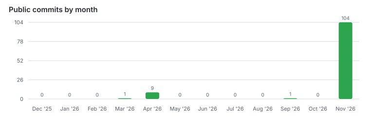
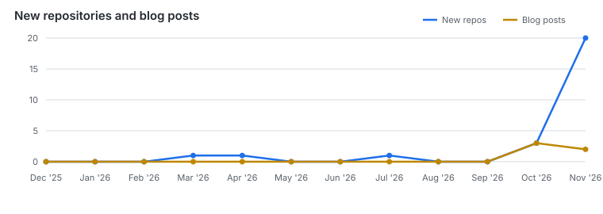

# About

I [read](https://z-library.sk/profile/45325055/0f1fbf), [code](https://github.com/cmduyeen/self-study), and cook.

[ISFJ](https://www.16personalities.com/isfj-personality).

# My stuff

<!-- MY-STUFF:START -->
### 2026
#### Nov
`T11-1` -> [chinese-lunar-calendar](https://github.com/cmduyeen/chinese-lunar-calendar)
`T11-2` -> [pinkie-products](https://github.com/cmduyeen/pinkie-products)
`T11-3` -> [pinkie-smart-toc](https://github.com/cmduyeen/pinkie-smart-toc)
`T11-4` -> [pinkie-sumatrapdf](https://github.com/cmduyeen/pinkie-sumatrapdf)
`T11-5` -> [pinkie-terminal](https://github.com/cmduyeen/pinkie-terminal)
`T11-6` -> [pinkie-obsidian](https://github.com/cmduyeen/pinkie-obsidian)
`T11-7` -> [pinkie-vscode-icons](https://github.com/cmduyeen/pinkie-vscode-icons)
`T11-8` -> [pinkie-vscode](https://github.com/cmduyeen/pinkie-vscode)
`T11-9` -> [pinkie-chrome](https://github.com/cmduyeen/pinkie-chrome)
`T11-10` -> [pinkie-theme](https://github.com/cmduyeen/pinkie-theme)

#### Oct
`T10-1` -> [self-study](https://github.com/cmduyeen/self-study)
`T10-2` -> [books](https://github.com/cmduyeen/books)
`T10-3` -> [cmduyeen.github.io](https://github.com/cmduyeen/cmduyeen.github.io)

#### Jul
`T07-1` -> [pinkie-extension-styler](https://github.com/cmduyeen/pinkie-extension-styler)

#### Apr
`T04-1` -> [lich-am-viet-nam](https://github.com/cmduyeen/lich-am-viet-nam)

#### Mar
`T03-1` -> [python-file-organizer-robot](https://github.com/cmduyeen/python-file-organizer-robot)

### 2025
#### Jun
`T06-1` -> [Focus-Assistant-Extension](https://github.com/cmduyeen/Focus-Assistant-Extension)
`T06-2` -> [Pomodoro-Timer-PowerShell](https://github.com/cmduyeen/Pomodoro-Timer-PowerShell)

#### Apr
`T04-1` -> [CleanWindowsCMD-Free-Safe](https://github.com/cmduyeen/CleanWindowsCMD-Free-Safe)
<!-- MY-STUFF:END -->

# Blog

<!-- BLOG-POST-LIST:START -->
- 2026-10-16: [Từ Obsidian đến GitHub Pages, Phần 3: Kiểm tra RSS và đồng bộ hồ sơ](https://cmduyeen.github.io/posts/obsidian-to-github-blog-03-test-rss-and-profile-sync/)
- 2026-10-15: [Từ Obsidian đến GitHub Pages, Phần 2: Xuất bản Markdown bằng Hugo](https://cmduyeen.github.io/posts/obsidian-to-github-blog-02-publish-with-hugo/)
- 2026-10-14: [Từ Obsidian đến GitHub Pages, Phần 1: Tạo vault sẵn sàng xuất bản](https://cmduyeen.github.io/posts/obsidian-to-github-blog-01-publishable-vault/)
<!-- BLOG-POST-LIST:END -->

# Productivity

<!-- PRODUCTIVITY:START -->
Commit counts include commits GitHub attributes to @cmduyeen on default branches of public repositories. The trend chart shows new repositories and blog posts per month from the public repository list and RSS feed.

<!-- PRODUCTIVITY:END -->
