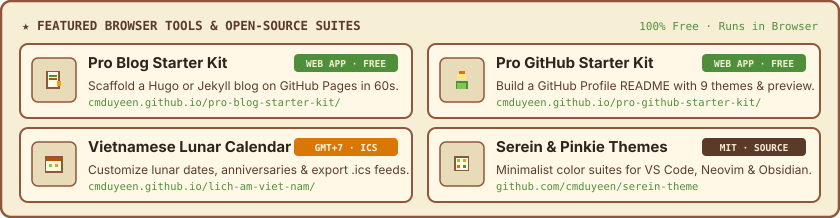

  

  
  
  
  

  

<!-- MY-STUFF:START -->

2026-32R

<ol>
<li><code>NOV-17</code> -&gt; <a href="https://github.com/cmduyeen/pro-blog-starter-kit">pro-blog-starter-kit</a></li>
<li><code>NOV-17</code> -&gt; <a href="https://github.com/cmduyeen/pro-github-starter-kit">pro-github-starter-kit</a></li>
<li><code>NOV-14</code> -&gt; <a href="https://github.com/cmduyeen/malaysia-lunar-calendar">malaysia-lunar-calendar</a></li>
<li><code>NOV-14</code> -&gt; <a href="https://github.com/cmduyeen/singapore-lunar-calendar">singapore-lunar-calendar</a></li>
<li><code>NOV-14</code> -&gt; <a href="https://github.com/cmduyeen/korean-lunar-calendar">korean-lunar-calendar</a></li>
<li><code>NOV-14</code> -&gt; <a href="https://github.com/cmduyeen/macao-lunar-calendar">macao-lunar-calendar</a></li>
<li><code>NOV-14</code> -&gt; <a href="https://github.com/cmduyeen/hong-kong-lunar-calendar">hong-kong-lunar-calendar</a></li>
<li><code>NOV-14</code> -&gt; <a href="https://github.com/cmduyeen/taiwan-lunar-calendar">taiwan-lunar-calendar</a></li>
<li><code>NOV-14</code> -&gt; <a href="https://github.com/cmduyeen/serein-neovim">serein-neovim</a></li>
<li><code>NOV-12</code> -&gt; <a href="https://github.com/cmduyeen/serein-theme">serein-theme</a></li>
<li><code>NOV-12</code> -&gt; <a href="https://github.com/cmduyeen/serein-vimium">serein-vimium</a></li>
<li><code>NOV-12</code> -&gt; <a href="https://github.com/cmduyeen/serein-telegram">serein-telegram</a></li>
<li><code>NOV-12</code> -&gt; <a href="https://github.com/cmduyeen/serein-sublime-text">serein-sublime-text</a></li>
<li><code>NOV-12</code> -&gt; <a href="https://github.com/cmduyeen/serein-windows">serein-windows</a></li>
<li><code>NOV-12</code> -&gt; <a href="https://github.com/cmduyeen/serein-codex">serein-codex</a></li>
<li><code>NOV-12</code> -&gt; <a href="https://github.com/cmduyeen/serein-antigravity">serein-antigravity</a></li>
<li><code>NOV-12</code> -&gt; <a href="https://github.com/cmduyeen/serein-vscode">serein-vscode</a></li>
<li><code>NOV-12</code> -&gt; <a href="https://github.com/cmduyeen/serein-obsidian">serein-obsidian</a></li>
<li><code>NOV-12</code> -&gt; <a href="https://github.com/cmduyeen/serein-terminal">serein-terminal</a></li>
<li><code>NOV-08</code> -&gt; <a href="https://github.com/cmduyeen/chinese-lunar-calendar">chinese-lunar-calendar</a></li>
<li><code>NOV-08</code> -&gt; <a href="https://github.com/cmduyeen/pinkie-sumatrapdf">pinkie-sumatrapdf</a></li>
<li><code>NOV-08</code> -&gt; <a href="https://github.com/cmduyeen/pinkie-terminal">pinkie-terminal</a></li>
<li><code>NOV-08</code> -&gt; <a href="https://github.com/cmduyeen/pinkie-obsidian">pinkie-obsidian</a></li>
<li><code>NOV-08</code> -&gt; <a href="https://github.com/cmduyeen/pinkie-vscode-icons">pinkie-vscode-icons</a></li>
<li><code>NOV-08</code> -&gt; <a href="https://github.com/cmduyeen/pinkie-vscode">pinkie-vscode</a></li>
<li><code>NOV-08</code> -&gt; <a href="https://github.com/cmduyeen/pinkie-chrome">pinkie-chrome</a></li>
<li><code>NOV-08</code> -&gt; <a href="https://github.com/cmduyeen/pinkie-theme">pinkie-theme</a></li>
<li><code>OCT-21</code> -&gt; <a href="https://github.com/cmduyeen/self-study">self-study</a></li>
<li><code>OCT-16</code> -&gt; <a href="https://github.com/cmduyeen/cmduyeen.github.io">cmduyeen.github.io</a></li>
<li><code>JUL-20</code> -&gt; <a href="https://github.com/cmduyeen/pinkie-extension-styler">pinkie-extension-styler</a></li>
<li><code>APR-23</code> -&gt; <a href="https://github.com/cmduyeen/lich-am-viet-nam">lich-am-viet-nam</a></li>
<li><code>MAR-25</code> -&gt; <a href="https://github.com/cmduyeen/python-file-organizer-robot">python-file-organizer-robot</a></li>
</ol>

2025-3R

<ol>
<li><code>JUN-10</code> -&gt; <a href="https://github.com/cmduyeen/Focus-Assistant-Extension">Focus-Assistant-Extension</a></li>
<li><code>JUN-04</code> -&gt; <a href="https://github.com/cmduyeen/Pomodoro-Timer-PowerShell">Pomodoro-Timer-PowerShell</a></li>
<li><code>APR-10</code> -&gt; <a href="https://github.com/cmduyeen/CleanWindowsCMD-Free-Safe">CleanWindowsCMD-Free-Safe</a></li>
</ol>

<!-- MY-STUFF:END -->

<!-- BLOG-POST-LIST:START -->
-  <a href="https://cmduyeen.github.io/posts/obsidian-vs-notion-for-builders/">Obsidian vs Notion in 2026: Which Free System Should Builders Choose?</a>
-  <a href="https://cmduyeen.github.io/posts/vietnamese-lunar-calendar-google-apple-calendar/">Add a Vietnamese Lunar Calendar (GMT+7) to Google &amp; Apple Calendar Without Extra Apps</a>
-  <a href="https://cmduyeen.github.io/posts/build-github-profile-and-blog-in-60-seconds/">Build a Pro GitHub Profile and Personal Blog in 60 Seconds — 100% Free</a>
-  <a href="https://cmduyeen.github.io/posts/markdown-101-10-capstone-practice/">Capstone Practice - Write a Complete Markdown Article from Scratch (Markdown 101 - Part 10)</a>
-  <a href="https://cmduyeen.github.io/posts/markdown-101-04-links-and-images/">How to Add Links and SEO-Friendly Images in Markdown (Markdown 101 - Part 04)</a>
<!-- BLOG-POST-LIST:END -->

<!-- PRODUCTIVITY:START -->

<!-- PRODUCTIVITY:END -->
