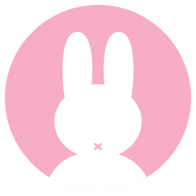



  

<h1 align="center">Hi there, I'm Duyên (cmduyeen) 🌸</h1>

  Crafting soft, aesthetic digital spaces & cozy pastel tools for peaceful daily workflows. (´｡• ᵕ •｡`) ♡

  
  
  
  

---

### 🌸 About Me

- 📖 **Things I enjoy**: Reading books, mindful note-taking in Obsidian, exploring aesthetic design systems, and thoughtful coding.
- 🧘‍♀️ **Personality**: [ISFJ](https://www.16personalities.com/isfj-personality) — quiet, warm, and attentive to subtle visual harmony.
- 🎨 **Creative Focus**: Creator and maintainer of the **Pinkie Ecosystem**, a soft pastel-pink and milky-white aesthetic designed to soothe the senses and eliminate eye strain.

---

### 💖 The Pinkie Ecosystem

Every port is built around the **Pinkie Design Tokens** to bring calming visual consistency across all daily tools:

| Port / Platform | Repository | Description | Status |
| :--- | :--- | :--- | :---: |
| 🎨 **Design Tokens** | [**`pinkie-theme`**](https://github.com/cmduyeen/pinkie-theme) | Master design tokens, specifications & color palette | Active |
| 🌸 **Web Extension Styler** | [**`pinkie-extension-styler`**](https://github.com/cmduyeen/pinkie-extension-styler) | Kawaii web customizer for Facebook, YouTube, Gemini, GitHub... | Active |
| 🌐 **Chrome Browser Theme** | [**`pinkie-chrome`**](https://github.com/cmduyeen/pinkie-chrome) | Aesthetic pink browser frame, tabs & toolbar theme | Active |
| 💻 **VS Code Theme** | [**`pinkie-vscode`**](https://github.com/cmduyeen/pinkie-vscode) | Soft pastel pink syntax and editor theme for VS Code | Active |
| 📁 **VS Code Icons** | [**`pinkie-vscode-icons`**](https://github.com/cmduyeen/pinkie-vscode-icons) | Cute pastel file and folder icons for VS Code | Active |
| 📓 **Obsidian Theme** | [**`pinkie-obsidian`**](https://github.com/cmduyeen/pinkie-obsidian) | Clean, cozy pastel theme for Obsidian note-taking | Active |
| 💻 **Terminal Theme** | [**`pinkie-terminal`**](https://github.com/cmduyeen/pinkie-terminal) | Windows Terminal, Alacritty, WezTerm & Starship | Active |
| 📖 **SumatraPDF Theme** | [**`pinkie-sumatrapdf`**](https://github.com/cmduyeen/pinkie-sumatrapdf) | Gentle pastel reading theme for SumatraPDF | Active |
| 📑 **Smart TOC** | [**`pinkie-smart-toc`**](https://github.com/cmduyeen/pinkie-smart-toc) | Floating aesthetic table of contents extension | Active |
| 🚀 **Products Hub** | [**`pinkie-products`**](https://github.com/cmduyeen/pinkie-products) | Full ecosystem directory & showcase portal | Active |

---

### 📚 Reading & Knowledge

- 📖 [**Reading Notes & Book Summaries**](https://github.com/cmduyeen/cmd_read_books): My personal library, reading trackers, and notes on literature and growth.
- 💡 [**Code Snippets & Learning Lab**](https://github.com/cmduyeen/cmd_learn_code): Curated algorithms, web snippets, and experiments.

---

### 🛠️ Tech Stack & Tools

  
  
  
  
  
  
  
  

---

### 📈 GitHub Stats (Pinkie Theme)

  
  

---

  Made with gentle love and care • <a href="https://github.com/cmduyeen">cmduyeen</a> 🌸

